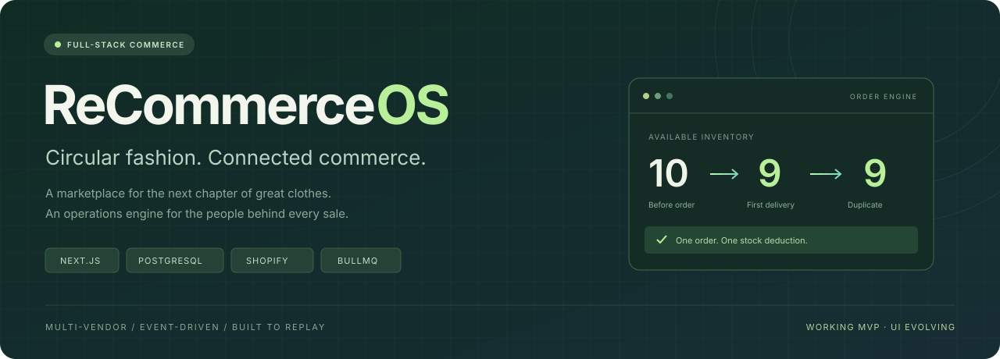
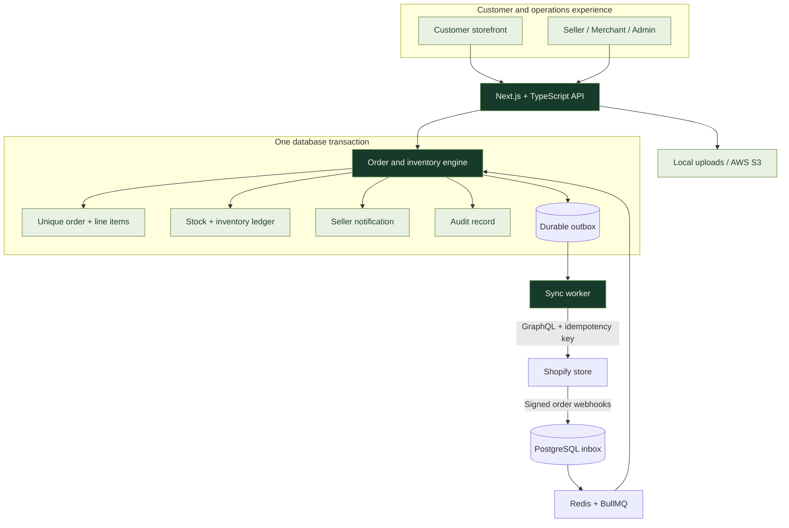
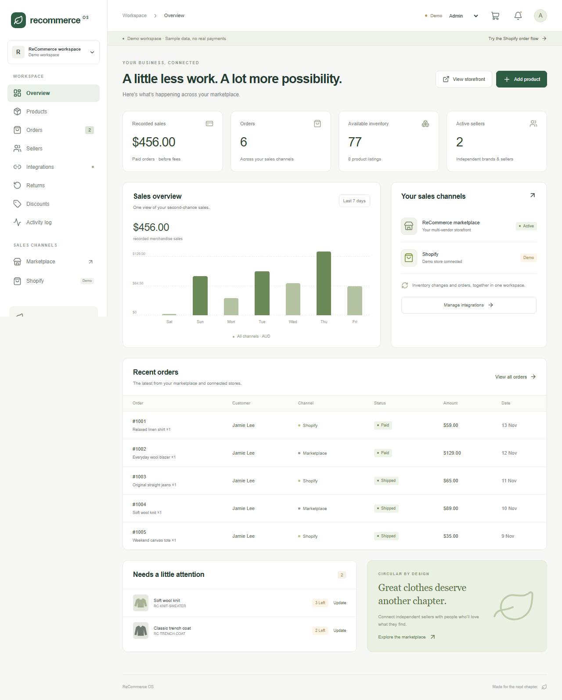

<div align="center">



### A second life for great clothes. One workspace for every sale.

A multi-vendor fashion marketplace with Shopify integration, transactional inventory,
<br />
and an order engine built to handle retries, duplicate webhooks and recovery.

<p>
  <a href="https://github.com/Czech-Knight/recommerce-os/actions/workflows/ci.yml"></a>
  
  
</p>

<!-- LIVE_DEMO_URL: replace this anchor with the verified website URL after the UI refresh and deployment. -->

<a href="#live-demo"></a>
<a href="#run-locally"></a>
<a href="#architecture"></a>

<br />
<br />

[The idea](#the-idea) · [Features](#four-roles-one-workspace) · [The order flow](#one-order-one-stock-deduction) · [Stack](#the-stack) · [Roadmap](#whats-next)

</div>

---

## Live demo

**Coming after the UI refresh.** The button above is ready for the hosted website URL. For now it opens this status section; no public website is deployed.

The application already runs locally with sample products and demo roles. The next phase is the storefront/dashboard redesign, followed by deployment and live-store verification.

[Launch the local demo →](#run-locally) · [Website release checklist →](docs/DEMO-RELEASE.md)

## The idea

A seller lists a linen shirt. A customer buys it on Shopify. The marketplace inventory changes, the order appears in the seller's dashboard, and the seller gets a notification.

Then Shopify delivers the same order event again.

**The system recognizes the order. Stock stays correct.**

ReCommerce OS brings customer discovery, seller operations and Shopify-connected commerce into a single application. It focuses on the parts of commerce that have to agree: who owns the listing, what is available, which orders have been processed, and what needs attention when something fails.

## Four roles, one workspace

| Experience   | What you can do                                                                                                                                               |
| :----------- | :------------------------------------------------------------------------------------------------------------------------------------------------------------ |
| **Customer** | Search by brand or product, filter condition/category, compare prices, explore product details, manage a persistent bag, apply discounts and request returns. |
| **Seller**   | Create listings with photos, prices, sizes and stock; manage inventory; view own order items, merchandise sales and notifications.                            |
| **Merchant** | Approve listings, manage pricing and discounts, inspect channel sales, connect Shopify, import/export products and retry failed events.                       |
| **Admin**    | Approve or suspend sellers, manage user access, review returns, restore inventory and inspect the audit trail.                                                |

<details>
<summary><strong>Explore the implementation</strong></summary>

<br />

| Module        | Under the hood                                                                                                                      |
| :------------ | :---------------------------------------------------------------------------------------------------------------------------------- |
| **Inventory** | Row locks, conditional stock updates, unique inventory movements, deterministic product lock ordering.                              |
| **Orders**    | Server-side pricing, customer-bound checkout keys, cart fingerprints, atomic order creation and 30-minute unpaid reservations.      |
| **Shopify**   | GraphQL Admin API, OAuth, encrypted expiring offline tokens, serialized refresh, variant-ID mapping and raw-body HMAC verification. |
| **Catalogue** | Paginated Shopify imports, approval workflow, deterministic draft exports and queued price/metadata updates.                        |
| **Recovery**  | PostgreSQL inbox/outbox, Redis/BullMQ jobs, exponential backoff, visible failed events and manual retry.                            |
| **Access**    | Scrypt passwords, hashed session tokens, HTTP-only cookies, role checks, ownership checks and origin validation.                    |
| **Media**     | PNG/JPEG/WebP upload validation, local storage and an AWS S3 adapter.                                                               |
| **Extras**    | Percentage discounts, return review/restocking, in-app notifications, category-based recommendations and a Liquid theme section.    |

</details>

## One order. One stock deduction.

The quickest way to understand this project is to replay an order.

| Step              | What happens                                                                                           | Example stock |
| :---------------- | :----------------------------------------------------------------------------------------------------- | :-----------: |
| **01 — Purchase** | A customer buys one mapped item in Shopify.                                                            |     `10`      |
| **02 — Receive**  | The app validates the signature and persists the event before acknowledging it.                        |     `10`      |
| **03 — Process**  | A transaction writes the order, stock movement, audit entry and seller notification.                   |      `9`      |
| **04 — Replay**   | Another delivery refers to the same Shopify order. Order-level idempotency prevents another deduction. |    **`9`**    |

Three checks protect this flow:

- **Event identity:** a unique `(shop_id, topic, event_id)` prevents duplicate inbox records.
- **Order identity:** a unique `(source, external_id)` catches repeated business events even when delivery IDs differ.
- **Atomic writes:** stock, order items, inventory movements and notifications commit together or roll back together.

Shopify has already reduced its own stock when it sends a sale event. ReCommerce updates its local inventory and excludes that source store from the outbound decrement. Changes originating in ReCommerce use a persistent job ID as the Shopify mutation's idempotency key.

> Local inventory changes are transactional. Synchronization across independent sales channels is asynchronous; this MVP does not promise globally atomic checkout across Shopify and the marketplace.

## Architecture



The database is the durable source of pending work. The worker rediscovers unfinished inbox/outbox records after interruptions, so accepting a webhook does not depend on Redis being available at that moment.

[Read the full engine and deployment notes →](docs/DEVELOPMENT.md#how-duplicate-protection-works)

## The stack

<p>
  
  
  
  
  
  
  
  
  
  
  
</p>

**Also:** BullMQ · PGlite for the local demo · Zod · Shopify Liquid · AWS SDK for S3.

## Run locally

**Node.js 22+ is required.** The local demo needs no Shopify credentials, Redis service or external PostgreSQL server.

```bash
git clone https://github.com/Czech-Knight/recommerce-os.git
cd recommerce-os
npm ci
npm run dev
```

Open **http://127.0.0.1:3000**. Demo data is stored in `.data/demo` using PGlite; the top bar lets you switch roles.

### A two-minute walkthrough

1. Open **Integrations** and select **Simulate Shopify order**.
2. Watch inventory decrease and an order appear in the event history.
3. Select **Replay duplicate webhook**. The quantity stays unchanged.
4. Switch to **Seller** to inspect the order and notification.
5. Switch to **Customer**, shop the catalogue, and use `SECONDCHANCE` at demo checkout for 10% off.

Demo checkout creates test orders and takes no payment. Real Shopify connections and demo role switching are separated by the runtime configuration.

<details>
<summary><strong>Current working prototype — UI redesign planned</strong></summary>

<br />



The screenshot shows the current functional demo. Visual design, storefront polish and final responsive refinement are part of the next phase.

</details>

### Connect the infrastructure

For the PostgreSQL/Redis stack, copy `.env.example` to `.env`, fill the required configuration and follow the development guide.

```bash
docker compose up --build -d
docker compose exec web npm run db:admin
```

[Database and worker setup →](docs/DEVELOPMENT.md#postgresql--redis-backend) · [Shopify development store setup →](docs/DEVELOPMENT.md#connect-a-shopify-development-store) · [AWS deployment path →](docs/DEVELOPMENT.md#aws-deployment-path)

## Verification

**20 core/adapter tests. 5 browser flows.** The CI badge at the top reports the current GitHub Actions result.

| Coverage                | Examples                                                                                                                     |
| :---------------------- | :--------------------------------------------------------------------------------------------------------------------------- |
| **Inventory integrity** | Duplicate deliveries, two customers competing for the last unit, multi-line rollback, return restocking once.                |
| **Order correctness**   | Out-of-order paid/create events, checkout-key reuse, authoritative pricing, discount calculation, failed-event recovery.     |
| **Access boundaries**   | Seller-scoped data, private operational records, roles, request origins, passwords and signed callbacks.                     |
| **Shopify adapters**    | Encrypted token rotation, immutable retry keys, old-job reconciliation guard, draft export and latest-price synchronization. |
| **Browser journeys**    | Order replay, customer checkout, seller approval, unauthorized requests and mobile navigation.                               |

```bash
npm run typecheck
npm test
npm run build
npx playwright install chromium
npm run test:e2e
```

CI is configured to run the engine suite against both PGlite and a PostgreSQL service, then build and run Chromium journeys. Shopify HTTP responses in adapter tests are mocked; successful tests do not replace real development-store validation.

## What's next

- [x] Multi-role marketplace and operational dashboards
- [x] Transactional order/inventory engine and replay protection
- [x] Shopify authentication, signed webhooks and catalogue adapters
- [x] Durable job recovery, tests, Docker and CI configuration
- [ ] **Redesign and polish the storefront/dashboard UI**
- [ ] **Deploy the website and activate the Live Demo button**
- [ ] Validate real Shopify test orders and the PostgreSQL/Redis worker end to end
- [ ] Payment-provider integration, seller payouts and refund automation
- [ ] External inventory/order reconciliation and multi-location support
- [ ] Email notifications, password recovery and broader dispute workflows

## Project status

This is a **working portfolio MVP**. Payment processing, split payouts, automatic refunds and shipping/tax services are not connected. Live marketplace checkout currently creates an unpaid reservation; return approval restores stock but does not refund money.

The operational model is one workspace, AUD currency and one mapped inventory location per Shopify store. Make restocks in ReCommerce; external Shopify stock corrections, order edits and refunds require reconciliation. AWS deployment instructions and an S3 adapter are included, but cloud infrastructure has not been provisioned.

[Read all implementation boundaries →](docs/DEVELOPMENT.md#current-boundaries)

## Find your way around

```text
src/
├── app/                 Next.js pages, layout, styles and API routes
├── components/          Storefront, dashboards, forms and workspace UI
├── lib/
│   ├── engine.ts        Orders, inventory movements and idempotency
│   ├── shopify.ts       GraphQL, token lifecycle and inventory sync
│   ├── catalog.ts       Catalogue import/export support and price sync
│   ├── auth.ts          Sessions, passwords, roles and origin checks
│   └── db.ts / schema.ts
└── worker.ts            BullMQ processing and durable-work recovery

tests/                   Engine/adapter tests and browser journeys
shopify/                 Optional Liquid theme section
docs/                    Detailed setup, release notes and README assets
.github/workflows/       Automated verification
```

<div align="center">

---

**ReCommerce OS** · Built by [Yash Aslekar](https://github.com/Czech-Knight)

<sub>Give great clothes another chapter. Keep every order accounted for.</sub>

</div>
