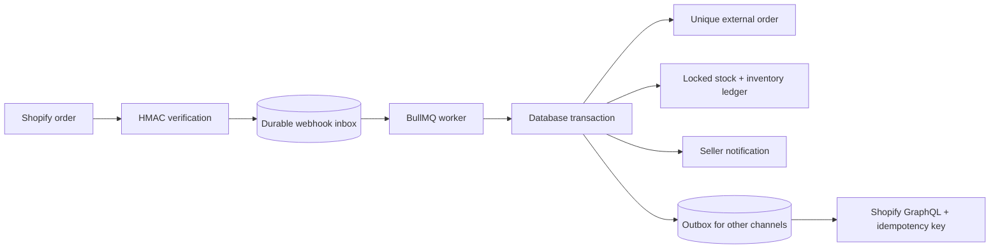

# ReCommerce OS — Development guide

[Back to the project overview](../README.md)

A runnable multi-vendor fashion marketplace with a deliberately simple React UI, role-based workspaces, a transactional inventory engine, and a real Shopify GraphQL adapter.

## Run the local demo

Requires Node.js 22+. No Shopify credentials, Docker, PostgreSQL server or Redis are needed for the demo.

```sh
npm install
npm run dev
```

Open **http://127.0.0.1:3000**. The initial demo role is Admin. Use the top-bar selector to try Merchant, Seller and Customer. Demo data persists in `.data/demo`; it is a local PGlite PostgreSQL database, not browser-only mock state. Only one web process should open this directory at a time. The live PostgreSQL configuration is intended for multiple processes.

Try the main demonstration:

1. Open **Integrations** and click **Simulate Shopify order**.
2. A linen-shirt order is created, stock falls by one and its seller receives an in-app notification.
3. Click **Replay duplicate webhook**. It uses another delivery/event identity for the same external order. Stock stays unchanged.
4. Switch to **Seller** and inspect Orders and Notifications.
5. Switch to **Customer**, open the marketplace, filter products, add to your bag and check out. `SECONDCHANCE` gives 10% off in the demo.

The demo uses the same transaction engine as live orders. It does not send Shopify requests, charge cards or send email. Its role selector bypasses login by design and is disabled in live mode. The development server binds to loopback.

## Included

| Area           | Implemented behavior                                                                                                                                                              |
| -------------- | --------------------------------------------------------------------------------------------------------------------------------------------------------------------------------- |
| Storefront     | Search, category/condition filters, price sorting, product details, related products, persistent cart, server-priced checkout                                                     |
| Seller         | Product creation/editing, image upload, per-size/SKU inventory, own order items, merchandise-sales summary, in-app notifications                                                  |
| Merchant       | Catalogue approval, pricing, cross-channel sales chart, orders, discounts, Shopify connections, event recovery                                                                    |
| Admin          | Seller approval/suspension, user role management, return review/restocking, audit trail                                                                                           |
| Authentication | Registration, scrypt passwords, hashed opaque session tokens, HTTP-only cookies, role/ownership checks, origin validation, per-account login throttling                           |
| Orders         | Atomic inventory/order/ledger/notification writes, order-level idempotency, conditional stock updates, unpaid reservation expiry                                                  |
| Shopify        | OAuth with expiring offline tokens, AES-256-GCM token encryption, serialized token refresh, paginated variant import, draft export, approved price/metadata sync, signed webhooks |
| Jobs           | PostgreSQL inbox/outbox, BullMQ retries with backoff, failed-event retry UI, rediscovery after Redis loss                                                                         |
| Assets         | Local PNG/JPEG/WebP uploads or AWS S3; original SVG demo garment illustrations; optional Shopify Liquid section                                                                   |
| Delivery       | Docker Compose, GitHub Actions, TypeScript checks, transaction tests and Playwright browser flows                                                                                 |

Each listing represents one sellable variant/size. To list multiple sizes, create separate SKUs. Inventory mapping uses Shopify variant IDs, never SKU matching alone.

## PostgreSQL + Redis backend

Start Docker Desktop first. Copy `.env.example` to `.env`; leave `DEMO_MODE=false` and set a strong bootstrap `ADMIN_EMAIL` / `ADMIN_PASSWORD` (12+ characters).

```sh
# Complete container stack: migration, web, worker, PostgreSQL and Redis
# Stop any local Next.js process using port 3000 first.
docker compose up --build -d
docker compose exec web npm run db:admin
```

Open **http://localhost:3000** and sign in through the account button. Remove the bootstrap password from `.env` after creating the administrator. Accounts can register as customers or pending sellers. No demo accounts are seeded in live mode.

Alternatively, run infrastructure in Docker and application processes locally:

```sh
docker compose up -d postgres redis
npm run db:migrate
npm run db:admin
npm run dev
# In another terminal:
npm run worker
```

Next.js reads `.env`; the worker and database scripts load it explicitly. `APP_URL` must exactly match the browser origin, including port. Use a public HTTPS origin for Shopify. API cookies are secure when `APP_URL` is HTTPS. `npm run build && npm start` requires PostgreSQL configuration unless `DEMO_MODE=true` is explicitly supplied.

The database schema is idempotent bootstrap SQL in `src/lib/schema.ts`, applied by the migration command. Schema evolution beyond this initial application should use versioned migrations. Docker keeps database, Redis and upload data in named volumes.

## Connect a Shopify development store

1. Create a Shopify app and an **AUD** development store. This is a standalone app, not an embedded admin app.
2. Set `SHOPIFY_CLIENT_ID`, `SHOPIFY_CLIENT_SECRET`, `APP_URL`, and a 64-character hex `TOKEN_ENCRYPTION_KEY` in `.env`.
3. Generate the encryption key locally: `node -e "console.log(require('crypto').randomBytes(32).toString('hex'))"`. Keep the same key for web and worker.
4. Update the placeholders in `shopify.app.toml`, including the OAuth redirect `https://YOUR_HOST/api/shopify/callback`. Configure the listed scopes and webhook subscriptions through Shopify CLI/app configuration. Do not assume OAuth creates the subscriptions for you.
5. Run PostgreSQL, Redis, the web app and the worker. Expose the app with an HTTPS development tunnel and use that origin in the browser.
6. Sign in as Admin/Merchant, open Integrations, and connect `your-store.myshopify.com`.
7. Select the intended inventory location and seller, then import. Approve imported listings in Products. Complete initial mapping while test sales are paused; importing during active sales needs a reconciliation pass.
8. Place a Shopify test order with a mapped variant. `orders/create` is authenticated and saved to the inbox before returning HTTP 200. The worker updates ReCommerce stock, order records, ledger and seller notifications.
9. Replay the signed order webhook, or deliver `orders/paid` before/after `orders/create`. The `(source, external_id)` uniqueness constraint prevents a second stock decrement even when delivery IDs differ.
10. Change central stock or place a marketplace order. The worker sends an incremental `inventoryAdjustQuantities` mutation with the durable job ID as Shopify's idempotency key. The source Shopify store is excluded when processing its own sale.

`SHOPIFY_API_VERSION` is pinned to `2026-10`. Access/refresh tokens are encrypted at rest. Refreshes acquire the shop row lock so parallel jobs do not rotate the token twice. Uninstall events revoke local access and clear stored tokens.

**Catalogue export:** after selecting a location through import, choose an approved, unlinked listing and use **Export Shopify draft**. A deterministic handle prevents duplicate drafts on retry. Inventory starts at zero and is initialized by the outbox. Wait for inventory jobs to complete, add/verify media, then publish the draft in Shopify. Approved edits sync pricing. Parent metadata sync is limited to products this app exported, to avoid renaming sibling variants on imported products. Shopify options, media and metafield publication are not automatically mirrored.

**Inventory authority:** make restocks and corrections in ReCommerce. Orders placed in Shopify update ReCommerce, and marketplace orders/central stock adjustments update Shopify. Arbitrary Shopify inventory edits, refunds, order edits, external fulfillment events and multi-location transfers are not automatically reconciled. A missing/short local quantity leaves the whole event failed for investigation; it does not partially process an order. Multiple independent storefronts can still sell concurrently before asynchronous synchronization catches up; this MVP does not claim globally atomic checkout across Shopify and the marketplace.

Shopify order totals shown here are the mapped line-item merchandise amounts before Shopify tax, shipping and discounts. They are operational figures, not payout or accounting statements. Unmapped lines remain outside the marketplace order. Initial import establishes an inventory baseline; it does not import historical orders.

## How duplicate protection works



- Inbox uniqueness: `(shop_id, topic, event_id)`. Delivery ID is a fallback when event ID is absent.
- Business uniqueness: `(source, external_id)` on orders; inventory movement keys are also unique.
- Checkout retries bind a key to the authenticated customer and a hash of the cart/address/discount. Reusing it with a changed request fails.
- Transactions lock products in a deterministic order and reject negative stock. An exception rolls back the order, stock, ledger and notifications together.
- The worker scans the durable inbox/outbox every five seconds. An HTTP process crash after persistence or a temporary Redis outage does not lose an accepted event.
- Five failed attempts leave a visible failed record. Retry is available after correcting the cause. Inventory jobs older than 23 hours require manual reconciliation because a provider's idempotency cache is not permanent; blindly retrying an old ambiguous mutation could double-apply it.
- Unpaid marketplace reservations expire after 30 minutes while the worker is running. Return approval restores stock once; it does not issue a payment refund.

## Tests

```sh
npm run typecheck
npm test
npm run build
npx playwright install chromium
npm run test:e2e
```

The 20 core tests use real embedded PostgreSQL semantics and mocked Shopify HTTP responses. They cover webhook/order duplicates, out-of-order paid/create events, rollback/recovery, competing checkout attempts, server-side pricing, discounts, return idempotency, access isolation, signatures, encrypted token refresh, outbound idempotency, draft export and current-price sync.

Set `TEST_DATABASE_URL` to also run this suite with a PostgreSQL server. It creates and removes a randomly named isolated test schema; use a test database. CI runs both database variants, builds the app, then runs Playwright. The five browser tests cover the order demonstration, checkout, listing approval, access denial and mobile layout.

Playwright starts its own demo server with `.data/e2e` unless a development server is already running. For a clean isolated browser run, stop the existing server first. `E2E_EXTERNAL=1` uses an already running server; tests modify that server's demo data. Screenshots/traces are written under `test-results/`.

On a restricted Windows shell, browser downloads can be directed inside the workspace:

```powershell
$env:PLAYWRIGHT_BROWSERS_PATH = "$PWD/.data/browsers"
npx playwright install chromium
npm run test:e2e
```

## AWS deployment path

The repository contains a container and S3 adapter; it has not provisioned AWS infrastructure. For deployment, run the web and worker as separate ECS/Fargate services, use RDS PostgreSQL and ElastiCache Redis, terminate HTTPS at an ALB, and provide secrets through AWS Secrets Manager/task environment settings. Run migrations as a one-off task before the application rollout. Use the task role for S3 access rather than committing credentials. Configure `S3_BUCKET`, `AWS_REGION` and a public CloudFront media base URL; web replicas otherwise need shared upload storage.

## Current boundaries

This is an executable portfolio MVP, not a completed production marketplace. The UI is intentionally straightforward for later design work.

- No card payment provider, split seller payouts, shipping-label integration, automatic tax calculation or automated refunds. Live marketplace checkout creates an explicitly unpaid reservation; administrators can confirm externally received payment.
- Returns are request/review/restock workflows. A general dispute messaging/arbitration system is not implemented.
- Notifications are in-app with 15-second refresh. Email/SMS, password-reset email and email verification are not wired.
- Recommendations are deterministic same-category suggestions, not a learned model.
- One operational workspace, AUD currency and one inventory location per shop. Merchant users are workspace staff, not isolated independent tenants.
- No public Shopify App Store distribution/compliance workflow is claimed. Add the required privacy webhooks, data-retention policy, consent flows and operational review for that distribution model.
- Imported Shopify parent metadata, external stock corrections and refunds need reconciliation as described above. New draft media and publication are completed in Shopify.

Verified locally: TypeScript/build, embedded-database/adapter tests, and Chromium desktop/mobile flows. Docker daemon, real PostgreSQL/Redis worker execution, real Shopify test orders and AWS deployment must be verified in configured environments. No external store credentials were supplied.

## Source map

- `src/components/`: UI shell, storefront, dashboards, management and forms.
- `src/app/api/[...path]/route.ts`: API routing, permissions, uploads, authentication, webhook intake and OAuth.
- `src/lib/engine.ts`: checkout, inventory ledger, webhook processing and stock restoration.
- `src/lib/shopify.ts` / `catalog.ts`: GraphQL, encrypted tokens, import/export, inventory and price sync.
- `src/lib/db.ts` / `schema.ts`: PostgreSQL adapters and schema.
- `src/worker.ts`: BullMQ worker, inbox/outbox recovery and unpaid-order expiry.
- `shopify/blocks/recommerce-provenance.liquid`: optional theme section; copy to your theme's `sections` directory.

Shopify implementation references: [webhook headers](https://shopify.dev/docs/api/webhooks/latest), [standalone OAuth](https://shopify.dev/docs/apps/build/authentication-authorization/authenticate-standalone-apps), [token lifecycle](https://shopify.dev/docs/apps/build/authentication-authorization/access-tokens), [inventory adjustments](https://shopify.dev/docs/api/admin-graphql/2026-10/mutations/inventoryAdjustQuantities), [productSet](https://shopify.dev/docs/api/admin-graphql/2026-10/mutations/productSet).
